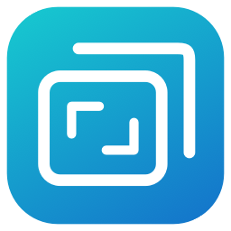
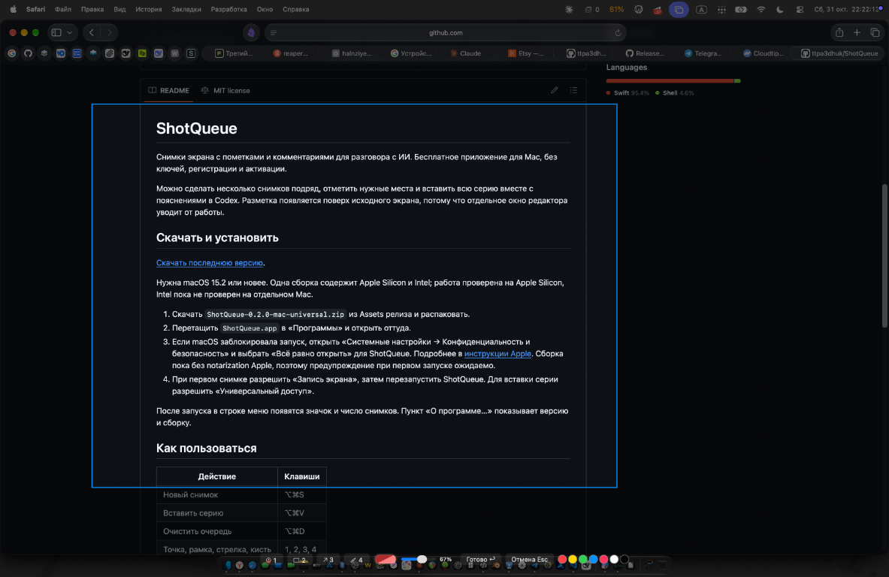
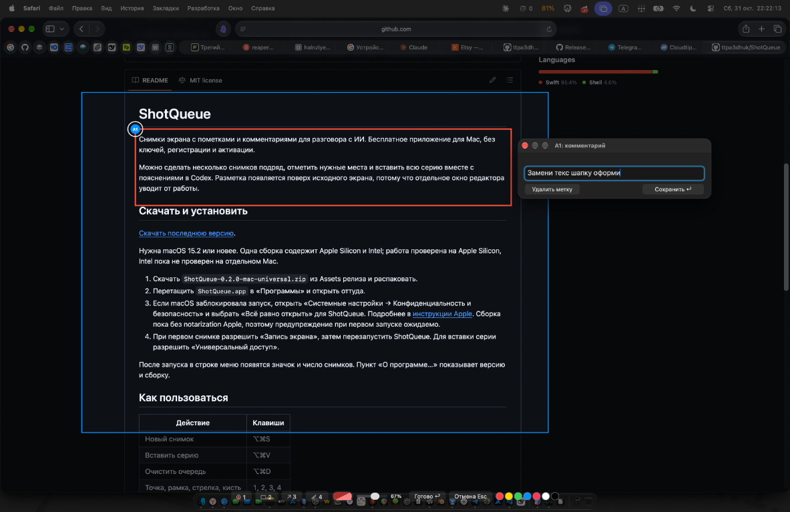
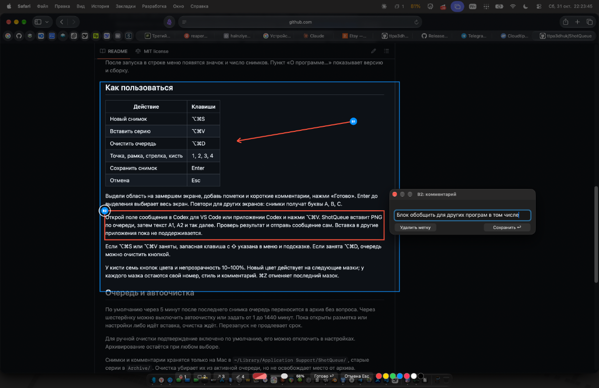
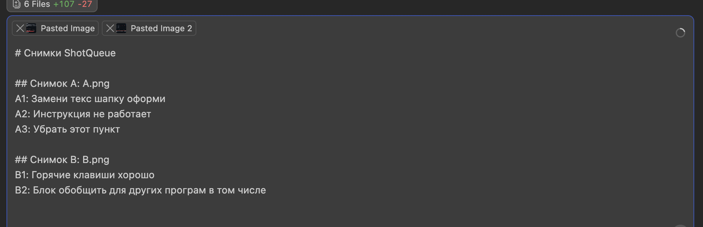
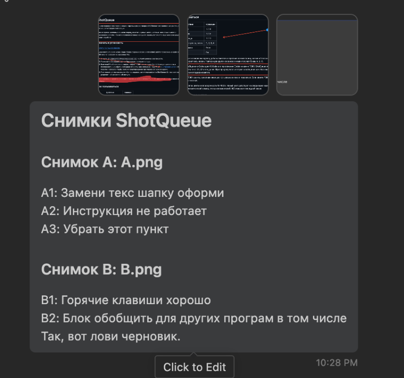

<p align="center">
  
</p>
<h1 align="center">ShotQueue</h1>
<p align="center">Выдели область экрана, добавь пометки и комментарии, собери серию снимков.</p>
<p align="center">
  <a href="https://github.com/ttpa3dhuk/ShotQueue/releases/latest"><strong>Скачать для Mac</strong></a>
  · <a href="#как-это-работает">Как это работает</a>
  · <a href="https://pay.cloudtips.ru/p/b79fa042">Поддержать разработку</a>
</p>
<p align="center">macOS 15.2+ · Apple Silicon и Intel · Бесплатно · MIT</p>

ShotQueue нужен, когда проще показать несколько мест на экране, чем объяснять их текстом. Разметка появляется поверх исходного экрана, потому что отдельное окно редактора уводит от работы. У каждой пометки свой номер и комментарий.

Без регистрации, подписки и ключей активации. Снимки хранятся на твоём Mac. Всю серию можно вставить в Codex одной горячей клавишей; для других программ готовые PNG и текст доступны в локальной папке ShotQueue.

## Скачать и установить

[Скачать последнюю версию](https://github.com/ttpa3dhuk/ShotQueue/releases/latest).

Нужна macOS 15.2 или новее. Одна сборка содержит Apple Silicon и Intel; работа проверена на Apple Silicon, Intel пока не проверен на отдельном Mac.

1. На странице релиза в разделе **Assets** выбрать файл `ShotQueue-0.2.0-mac-universal.zip`. Архивы `Source code` содержат исходники, для установки они не нужны. Распаковать скачанный ZIP.
2. Перетащить `ShotQueue.app` в «Программы» и открыть оттуда.
3. Если macOS заблокировала запуск, открыть «Системные настройки → Конфиденциальность и безопасность» и выбрать «Всё равно открыть» для ShotQueue. Подробнее в [инструкции Apple](https://support.apple.com/102445). Сборка пока без notarization Apple, поэтому предупреждение при первом запуске ожидаемо.
4. Нажать «Новый снимок» и разрешить ShotQueue «Запись экрана». Полностью закрыть приложение через его меню «Выход» и открыть снова из «Программ».
5. Для вставки серии разрешить ShotQueue «Универсальный доступ» в «Системные настройки → Конфиденциальность и безопасность».

## Как это работает

### 1. Выбери область экрана

Нажми ⌥⌘S или кнопку камеры на панели. Экран замрёт: протяни мышью прямоугольник вокруг нужного места. Синяя рамка показывает область будущего снимка, панель инструментов остаётся внизу.



### 2. Отметь место и напиши комментарий

Выбери инструмент цифрой 1–4 или кнопкой: точку, рамку, стрелку либо кисть. После пометки появится поле комментария. Введи текст и нажми «Сохранить». На снимке ниже рамка получила номер A1.



### 3. Добавь другие пометки и сохрани снимок

Можно сочетать инструменты: здесь стрелка B1 и рамка B2. Когда всё готово, нажми «Готово» на нижней панели. Повтори для других экранов, снимки получат буквы A, B, C.



### 4. Передай снимки вместе с комментариями

В Codex для VS Code или приложении Codex открой поле сообщения и нажми ⌥⌘V. ShotQueue вставит PNG по очереди, затем текст A1, A2 и так далее. Проверь вложения и комментарии перед отправкой.



В другую программу файлы можно прикрепить вручную: PNG и текст `session.md` лежат в `~/Library/Application Support/ShotQueue/`. Автоматическая вставка пока поддерживает только Codex.

Номера связывают комментарий с местом на снимке. Ниже пример уже отправленного сообщения; кнопку отправки нажимает сам пользователь, ShotQueue этого не делает.

<p align="center">
  
</p>

## Горячие клавиши

| Действие | Клавиши |
| --- | --- |
| Новый снимок | ⌥⌘S |
| Вставить серию | ⌥⌘V |
| Очистить очередь | ⌥⌘D |
| Точка, рамка, стрелка, кисть | 1, 2, 3, 4 |
| Сохранить снимок | Enter |
| Отмена | Esc |

Enter до выделения выбирает весь экран. Во время ввода комментария цифры остаются обычным текстом.

Если ⌥⌘S или ⌥⌘V заняты, запасная клавиша с ⇧ указана в меню и подсказке. Если занята ⌥⌘D, очередь можно очистить кнопкой.

У кисти семь кнопок цвета и непрозрачность 10–100%. Новый цвет действует на следующие мазки; у каждого мазка остаются свой номер, стиль и комментарий. ⌘Z отменяет последний мазок.

## Очередь и автоочистка

По умолчанию через 5 минут после последнего снимка очередь переносится в архив без вопроса. Через шестерёнку можно выключить автоочистку или задать от 1 до 1440 минут. Пока открыты разметка или настройки либо идёт вставка, очистка ждёт. Перезапуск не продлевает срок.

Для ручной очистки подтверждение включено по умолчанию, его можно отключить в настройках. Архивирование остаётся при любом выборе.

Снимки и комментарии хранятся только на Mac в `~/Library/Application Support/ShotQueue/`, старые серии в `Archive/`. Очистка убирает их из активной очереди, но не освобождает место от архива. Приложение не загружает снимки в сеть и не отправляет сообщения за тебя.

## Поддержать разработку

Если ShotQueue тебе полезен, можно [поддержать разработку донатом](https://pay.cloudtips.ru/p/b79fa042). Это добровольно, все функции доступны бесплатно. Та же ссылка есть в «О программе».

## Как собрать

Swift, AppKit и системный ScreenCaptureKit. Нужен Xcode с macOS SDK 15.2 или новее.

```sh
./scripts/build.sh
.build/ShotQueue.app/Contents/MacOS/ShotQueue --self-test
./scripts/package.sh
```

Скрипт собирает обе архитектуры. Если доступен Apple Development-сертификат, он используется для подписи, иначе сборка подписывается локально (ad hoc). Подпись разработчика для распространения и notarization пока не настроены.

Для обычной работы запускай установленную копию из «Программ». `scripts/run.sh` нужен для разработки.

## Если после обновления не получается сделать снимок

Полностью закрой ShotQueue через меню «Выход», затем открой из «Программ» и повтори снимок. После обновления 0.2.0 такой перезапуск восстановил захват на рабочем Mac; причина сбоя пока не установлена. Если не помогло, проверь разрешение «Запись экрана» для ShotQueue.

## Пока не работает или не проверено

Уже сохранённые снимки нельзя редактировать повторно. Отдельной очистки архива пока нет. Выбор и удаление метки, ⌘Z/⇧⌘Z, полный экран через Enter и несколько мониторов ждут полной проверки на живом Mac. Копирование текста при русской раскладке покрыто автопроверкой, но ручная проверка ещё нужна. Работа на Intel и установка из скачанного архива на чистом Mac пока не проверены.

## Лицензия

[MIT](./LICENSE). Для использования не нужны платная лицензия, подписка или ключ активации.
